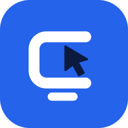
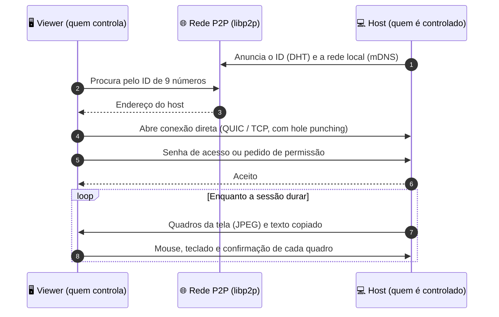

<div align="center">



# CDesk

**Controle remoto de computadores, direto e sem servidor central.**

[](https://go.dev)
[](https://wails.io)
[](https://libp2p.io)
[](#-compilar)
[](#-limitações-conhecidas)

</div>

---

## 📌 Resumo

> 🖥️ **CDesk** é um app de acesso remoto inspirado no AnyDesk: você digita o ID de outro computador e vê e controla a tela dele.
> 🔗 Os computadores se encontram e se conectam **direto entre si (P2P)**, sem servidor central, com conexão criptografada.
> 🔐 Cada acesso passa por um **pedido de permissão** em janela própria, ou entra sem aceite com uma **senha de acesso não supervisionado**.
> ✨ Tem abas para várias máquinas ao mesmo tempo, vários monitores, teclado completo, copiar e colar, status online e bandeja do sistema.
> ⚙️ Feito em **Go** e **Wails**, com interface em HTML, CSS e JavaScript puro, num único executável para Windows.

---

## ✨ O que já faz

### 🔌 Conexão

| | Recurso | Como funciona |
| :-: | --- | --- |
| 🆔 | **ID de 9 números** | Ex.: `610 104 309`. É permanente e calculado a partir da chave do computador. |
| 🌐 | **P2P, sem servidor** | Os computadores se acham pela rede P2P (DHT) e pela rede local (mDNS). |
| ⚡ | **Reconexão rápida** | Depois da primeira vez, o CDesk lembra os endereços: reconectar pelo histórico não procura na rede (a busca leva de 20 s a mais de 1 min). |
| 🟢 | **Quem está online** | O histórico mostra bolinha verde ou vermelha com o selo "Offline", atualizada a cada 30 s. A aba **Encontrados na rede** lista quem está na rede local. |
| 🔒 | **Criptografada** | Toda a conexão entre os computadores é criptografada. |

### 🛡️ Segurança

| | Recurso | Como funciona |
| :-: | --- | --- |
| 🔔 | **Pedido de permissão** | Abre numa **janela própria, sempre à frente**, como no AnyDesk, com Aceitar, Recusar e contagem regressiva. Sem resposta no prazo, recusa. |
| 🔑 | **Acesso não supervisionado** | Com uma senha definida (mínimo 6 caracteres), quem usa o ID e a senha entra sem ninguém aceitar. Quem conecta é solicitado a digitar a senha. |
| 💾 | **Lembrar senha** | Guarda a senha criptografada pelo Windows (DPAPI), para não digitar de novo ao reconectar pelo histórico. |
| ✅ | **Computadores permitidos** | Lista opcional: só os IDs dela podem pedir acesso. |
| 👁️ | **Só visualização** | Dá para desligar o controle: quem conecta só vê a tela. |

### 🖱️ Sessão remota

| | Recurso | Como funciona |
| :-: | --- | --- |
| 🗂️ | **Várias abas** | Várias máquinas ao mesmo tempo, com tela de carregamento que mostra o andamento (e deixa cancelar). |
| 🖥️ | **Vários monitores** | Com mais de um monitor no outro computador, botões numerados no topo escolhem qual ver. |
| ⌨️ | **Teclado completo** | O texto vai como caractere (ç, ã, é saem certos mesmo com teclados diferentes). Atalhos, setas e F1 a F12 vão como teclas. Teclas apertadas são soltas ao trocar de aba, para não ficarem presas. |
| 📋 | **Copiar e colar** | Ctrl+C num computador, Ctrl+V no outro (texto, só na aba em uso). |
| 📐 | **Sempre cabe na janela** | A tela remota se adapta à janela, sem barra de rolagem. |
| 🎞️ | **Imagem adaptativa** | Controle de fluxo e qualidade que se ajusta à velocidade da conexão; não envia nada com a tela parada. |

### 🧰 Aplicativo

| | Recurso | Como funciona |
| :-: | --- | --- |
| 📥 | **Bandeja do sistema** | Fechar a janela esconde o CDesk na bandeja, onde ele continua recebendo conexões. Só uma cópia roda por vez. |
| 🚀 | **Iniciar com o Windows** | Abre direto na bandeja. |
| ⚙️ | **Configurações** | **Geral**, **Segurança**, **Rede** (mDNS, UPnP, NAT, porta), **Exibição** (prioridade da imagem, quadros por segundo) e **Sobre**. |

---

## 🧭 Como funciona

Cada instalação do CDesk é ao mesmo tempo quem compartilha e quem controla.



1. 🔑 Ao abrir, o app gera uma chave (na pasta de configuração do usuário) e dela tira o ID de 9 dígitos.
2. 📡 O computador se anuncia na rede P2P ([libp2p](https://libp2p.io), DHT Kademlia) e, na rede local, por mDNS.
3. 🔎 Quem conecta digita o ID. O app procura o computador, **confere que o ID bate com a chave** do que foi encontrado e abre uma conexão direta (UDP/QUIC/TCP, com UPnP e *hole punching* para atravessar NAT).
4. 🙋 O outro lado aceita o pedido ou valida a senha, e a tela começa a ser enviada. O host só manda um quadro novo depois que o viewer confirma o anterior.
5. 🖱️ Mouse e teclado viajam no sentido contrário e são aplicados no computador controlado.

> [!IMPORTANT]
> A sessão só abre com conexão **direta**. Os relays públicos que ajudam a atravessar NAT limitam a sessão a cerca de 2 minutos e 128 KB, o que não aguenta vídeo.

---

## 🚀 Como usar

1. ▶️ Abra o CDesk nos dois computadores e espere a faixa ficar azul: **"Pronto. Este computador pode receber conexões."**
2. 🆔 No computador que será controlado, anote o ID em **Este dispositivo**.
3. ⌨️ No outro, digite o ID em **ID do computador remoto** e clique em **Conectar**.
4. 🔑 Se o computador tem senha de acesso, digite-a (e marque **Lembrar a senha**, se quiser) ou escolha **Pedir permissão**.
5. ✅ No computador controlado, clique em **Aceitar** (a menos que a senha de acesso tenha sido usada).
6. 🗂️ Para abrir outra máquina, volte à aba **Nova sessão**. Feche uma sessão no **×** da aba.

> [!TIP]
> Na primeira execução, o Windows pergunta se libera o CDesk no firewall. **Libere nas redes privada e pública**, senão as conexões de entrada ficam bloqueadas.

---

## 🛠️ Compilar

Precisa de [Go](https://go.dev/dl/) e do [Wails v2](https://wails.io/docs/gettingstarted/installation).

```bash
go install github.com/wailsapp/wails/v2/cmd/wails@latest
wails build
```

O executável sai em `build/bin/CDesk.exe`.

**Testes**

```bash
go test -short .     # protocolo, permissões, senha, abas, teclado... (sem internet)
go test .            # inclui a busca pela DHT (usa a internet)
```

---

## 🗂️ Estrutura

| Arquivo | Função |
| --- | --- |
| `main.go` | Janela Wails, bandeja e instância única; no modo `--ask` abre só o aviso de pedido |
| `app.go` | Rede P2P, ID, permissões, senha, sessões e conexão |
| `stream.go` | Envio da tela: controle de fluxo, qualidade adaptativa e entrega dos quadros |
| `clip.go` | Copiar e colar entre os computadores |
| `monitor.go` | Escolha de monitor quando o outro computador tem mais de um |
| `presence.go` | Quem está online e lista da rede local |
| `peers.go` | Endereços lembrados dos computadores já conectados (reconexão rápida) |
| `ask.go` | Aviso de pedido de acesso em outra janela (outro processo do CDesk) |
| `settings.go` | Configurações, salvas em `settings.json` |
| `savedpw.go`, `dpapi_*.go` | Senhas lembradas, criptografadas com o Windows (DPAPI) |
| `tray.go` | Ícone da bandeja |
| `input_windows.go` | Aplica mouse e teclado recebidos (API do Windows) |
| `input_other.go`, `startup_other.go`, `dpapi_other.go` | Stubs para outros sistemas (ainda não implementados) |
| `frontend/` | Interface: `index.html`, `app.js`, `keys.js`, `settings.js`, `ask.html` e os estilos |
| `assets/`, `build/appicon.png` | Logo do CDesk (bandeja e ícone do executável) |
| `*_test.go` | Testes do protocolo, permissão, senha, abas, teclado, área de transferência e presença |

---

## ⚠️ Limitações conhecidas

- 🪟 **Só Windows.** O controle de mouse e teclado ainda não existe em Linux e macOS.
- 👥 Um computador aceita **uma sessão por vez**.
- 🧱 Em redes com **CGNAT ou NAT simétrico** (alguns 4G e redes corporativas) a conexão direta pode não abrir. Falta um relay próprio.
- 🔓 A senha de acesso é enviada ao outro computador durante a conexão, sem desafio criptográfico. IDs de 9 dígitos podem ser forjados por força bruta de chaves, e senhas erradas são freadas só por um atraso simples, sem limite por computador.
- 🟠 **"Offline" pode ser falso** para computadores que só são achados pela rede P2P pública, que é lenta. Quem já conectou antes e quem está na rede local aparece de forma confiável.
- 🎞️ Vídeo em JPEG, sem áudio, sem transferência de arquivos nem chat. A área de transferência sincroniza só texto (até 256 KB).
- 🌍 Só em português. As opções "Verificar atualizações", "Mostrar o cursor remoto" e "Ocultar o papel de parede remoto" aparecem como "Em breve".

## 🗺️ Próximos passos

- [ ] 🌉 Relay próprio, para redes onde a conexão direta não abre
- [ ] 📁 Transferência de arquivos e 💬 chat
- [ ] 🖼️ Imagens na área de transferência
- [ ] 🎬 Vídeo mais eficiente (H.264, VP8 ou WebRTC)
- [ ] 🐧 Suporte a Linux e macOS
